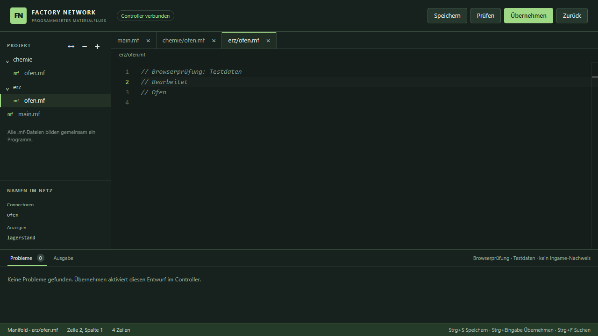

# Produktiver Web-Codeeditor — 6. September 2026

Der Terminal-Aufruf verwendet jetzt `index.html` mit dem echten Projekt aus der
Java-Brücke. Die bisherige Monaco-Messoberfläche bleibt als `demo.html` erhalten.
Sie ist kein Nachweis einer Verbindung zu einem Controller.

## Bedienung

- Explorer aus tatsächlichen `.mf`-Dateien mit einklappbaren Unterordnern.
- Dateien anlegen, umbenennen und aus dem Entwurf entfernen; die letzte Datei
  bleibt erhalten. Sperren anderer Spieler werden angezeigt und respektiert.
- Ein Monaco-Modell je Datei. Tabs schließen per Kreuz, Mittelklick oder
  Entf-Taste; Wiederöffnen behält Text und Cursorposition. Tab-Schließen löscht
  keine Datei und verwirft keinen Entwurf.
- Compilerdiagnosen mit Marker, genauer Quellspanne, Hinweis und Klick zur
  betroffenen Stelle, einschließlich anderer Dateien.
- Speichern (Strg+S), Projekt prüfen (Strg+Umschalt+B), Übernehmen
  (Strg+Eingabe) und Zurück. Der Serverzustand zeigt ausstehende
  Speicherbestätigungen und abgelehnte Speichervorgänge ausdrücklich an.
- Schlüsselwortvervollständigung und Gerätenamen ausschließlich aus der
  echten Zustandssynchronisierung. Keine erfundenen Laufzeitdaten oder
  Platzhalterdiagnosen in der produktiven Seite.

## Synchronisierung und Offline-Paket

`window.fnSend` sendet Aktionen bzw. `{type:'change', revision, files}`.
`window.fnReceive` übernimmt die Java-Snapshots. Eine ältere Revision kann den
neueren lokalen Text und die zugehörige Prüfung nicht überschreiben. Abgelehnte
Revisionen werden durch den autoritativen Java-Snapshot derselben Revision
zurückgesetzt. Die Bereitschaftsmeldung wird wiederholt, falls BambooCEFs
`fnSend` erst nach Monacos Initialisierung injiziert wird.

Dateigrenzen entsprechen `EditorProtocol`: 128 Dateien, 65.536 UTF-16-Codeeinheiten
je Datei und 256 KiB UTF-8 für das Gesamtprojekt einschließlich Dateinamen.
Wird die Größenbegrenzung während einer Eingabe überschritten, wird exakt der
vorherige akzeptierte Text wiederhergestellt. In diesem seltenen Fehlerfall wird
die Undo-Historie dieser einen Datei zurückgesetzt; der Text anderer Dateien
bleibt erhalten.

Monacos Standard-Worker lädt unter `file://` eine weitere Datei über
`importScripts`; Chromium blockiert das ohne Lockerung der Dateisicherheit.
`worker-source.js` enthält deshalb den bereits mitgelieferten Editorworker als
Textressource. Die produktive Seite startet ihn über eine Blob-URL. Der
Monaco-Generator erzeugt diese Ressource mit und hält das App-Manifest vollständig.
Es sind keine Remote-CDNs oder Browser-Sicherheitsflags erforderlich.

## Prüfung

- `node --test tools/tests/editor-state.test.cjs`: 8 Regressionstests erfolgreich.
- `node tools/tests/editor-browser.cjs`: echter Monaco in Headless-Chrome
  152.0.7977.77 über `file://`, ohne `allow-file-access`-Flags, erfolgreich.
  Playwright wird über `PLAYWRIGHT_MODULE` oder die normale Node-Auflösung geladen.
- Browserprüfung umfasst verspätete Bridge-Initialisierung, Ordner, Mittelklick
  und Wiederöffnen, veraltete Snapshots, Diagnosemarker und Navigation,
  Dateisperren, Anlegen/Umbenennen/Löschen, Shortcuts, laufende Übernahme,
  abgelehntes Speichern mit rotem Status, Größenlimit/Rücksetzung und
  HTML-sichere Ausgabe.
- Layout bei 1280×720 und 854×480 visuell geprüft; keine überlaufenden Bedienelemente.

**Der Screenshot zeigt einen Browser-Test mit injizierten Testdaten, keine
Ingame-Abnahme.** Minecraft-Start, Netzwerkpakete und die native CEF-Darstellung
werden gesondert durch den Hauptarbeitsgang geprüft. Serverseitige Berechtigungen
und Netzwerkzustand bleiben Aufgabe der bestehenden Java-Schicht.
